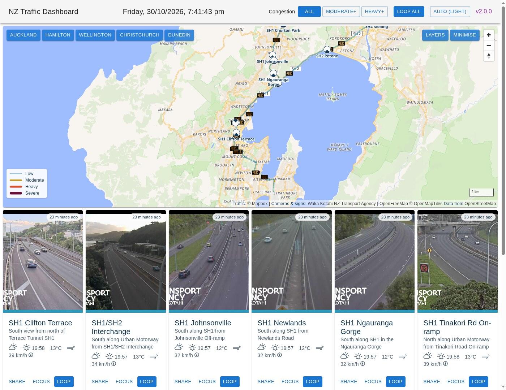

# traffic-dash

A dashboard for New Zealand traffic cameras, message signs and congestion.



A web app (React + MapLibre, built with Vite) with a small Node/Express server. The server proxies the NZTA traffic feeds, which can't be called from a browser because they send no CORS headers. It also keeps API keys out of the browser, shares upstream requests between viewers, and caches recent camera frames on disk so the cameras can be animated.

## Running

Requires Node 22+.

```sh
cp .env.template .env   # optional: fill in keys
npm install
npm run dev             # server on :3000, Vite dev server on :5173 (proxies /api to the server)
```

For production: `npm run build && npm start`, then open http://localhost:3000.

Other scripts: `npm test` (Node's built-in test runner; no extra dependencies) and `npm run lint`.

All keys are optional. Without them you still get cameras and variable message signs.

| Key | Meaning | Default |
|---|---|---|
| `OPENWEATHERMAP_APIKEY` | OpenWeatherMap API key: weather and sunrise/sunset per camera, and the rain layer (free tier OK) | |
| `MAPBOX_TOKEN` | Mapbox token: live traffic lines on the map, per-camera congestion and the congestion filter, from Mapbox Traffic v1 vector tiles (proxied and cached by the server; free tier OK) | |
| `MAP_STYLE` | Base map style URL | OpenFreeMap Liberty (no key) |
| `MAP_STYLE_DARK` | Base map style URL for the dark theme | `MAP_STYLE`, darkened by the server, so both themes are the same map |
| `PORT` | Server port | 3000 |
| `CACHE_ENABLED` | Cache camera frames to `cache/` for animation | true |
| `CACHE_MAX_AGE_HOURS` | Frames older than this are pruned | 6 |
| `VEHICLE_MODEL` | The vehicle detector (ONNX); vehicle counting is on when this file exists. See [scripts/vehicle-eval](scripts/vehicle-eval/readme.md) for where to get it | `models/dfine_s_coco.onnx` |
| `VEHICLE_COUNTS_DAYS` | Vehicle counts are kept this long, in `vehicle-counts/` | 7 |
| `VITE_MIN_REFRESH` / `VITE_MAX_REFRESH` | Each camera refreshes at a random interval in this range (ms) | 10000 / 25000 |

### Dev server quirk

Occasionally a file change isn't picked up by the dev server (`node --watch` for the server, or Vite for the client), and it keeps serving the old code; the symptom is a change that has no effect, or a blank page after an edit. Restart `npm run dev`, or save the file again.

## Using it

- **Map:** camera sites are circles with a quarter per direction the site has a camera for: filled when working, grey when offline. Hover a site for its cameras' recent footage, and to highlight the road segments its congestion came from; click it to pin its cameras.
- **Cards:** the cameras in view (up to 10 working ones, offline ones after) and any pinned cameras. Each loops the last 30 minutes, in sync with every other card. The coloured border is the congestion on the road the camera looks along.
- **Camera pages:** click a card's image for the camera's own page (`/camera/<id>`): the whole frame at full size, playback you control (Live, play/pause, step, and a scrubber across the saved history; space and the arrow keys work too), click-to-zoom on high-resolution cameras, its details, a small map of the cameras and signs around it (click a site to go there), the nearest lit message signs as their LED boards, nearby road events, and getting around: the site's other cameras, the nearest cameras on any road, the next camera either way along the state highway, and every camera on the route. Share copies the page's link; Back returns to the dashboard where you left it, or, if you've moved on from the first camera, centred where you ended up. Moving between cameras updates the page in place: the map pans to the next camera.
- **Congestion filter** (top bar): show only cameras at moderate or heavy congestion and worse.
- **Message signs:** small icons that expand into the sign on hover; shown in full from zoom 14.
- **Layers** (on the map): camera labels, message signs, road events, weather warnings, rain and congestion lines on or off. Rain and wind are off to start with. Rain is OpenWeatherMap's modelled precipitation, not radar; water on the base map is grey, so its blues stand out. Wind is Open-Meteo's forecast from ECMWF's global model, for the current hour, as faint wind barbs (into the wind; a half feather 5 knots, a full one 10, a pennant 50), the same size on screen at any zoom, and in the warning colour from 50 km/h.
- **Minimise:** shrinks the map to a card, keeping the area in view.
- **Theme** (top bar): Auto follows your system's light or dark setting; or pick Light or Dark.
- **Road events:** crashes, closures, roadworks and hazards, as NZ-road-sign-style icons; hover one for details. Cameras within 500m of a closure or delay are flagged on their cards.
- **Vehicles in view** (with the detector model): each frame the server saves is counted for cars, motorcycles, buses and trucks. Camera pages chart the last 3 hours: each frame's count, the average over 10 minutes, and its 95% band; cards show the last 30 minutes as a sparkline. Counts vary a lot frame to frame, as traffic bunches, so the trend is what to read; far-off and hidden vehicles are missed, so read it against the camera's own level, not as an exact number.
- **Weather warnings:** MetService's current watches and warnings, as areas tinted in their colour (yellow, orange or red); click inside one for its details. Cameras inside a warning are flagged on their cards and show it on their pages.

Settings (pins, filter, layers, looping, theme) and the map's position are remembered in the browser.

## How it works

- **Cameras and signs** come from the public [trafficnz.info REST API](https://trafficnz.info/service/traffic/rest/4/cameras/all), which replaced the old credentialed InfoConnect API. The server shares the lists between viewers for a minute, and each camera's image for 10 seconds.
- **Unavailable cameras:** NZTA sometimes serves a stock "This webcam is temporarily unavailable" image before marking a camera offline. The server recognises it (by its hash, or by the same image coming from several cameras), reports the camera as unavailable, and never caches it as a frame.
- **Animation:** frames are cached only while someone is viewing a camera, so a loop can be shorter than 30 minutes.
- **Vehicle counting** runs D-FINE (small, COCO-trained, Apache-2.0) through onnxruntime on the server, about 0.3 s a frame on a CPU, one frame at a time: new frames first, then any cached before a restart. Like the frames, counts exist only for cameras someone has viewed.
- **Cross-origin isolation:** the server (and Vite) send `Cross-Origin-Opener-Policy: same-origin` and `Cross-Origin-Embedder-Policy: credentialless`, so the wind layer can share its weather data with its workers instead of copying it for every tile. Anything embedded from another site must allow CORS.
- **Congestion** is read from Mapbox Traffic v1 tiles in the browser: each camera is matched to segments within 200m, heading the way it looks, on the most important road nearby. NZTA's camera direction is sometimes a route label rather than a compass bearing (e.g. SH16 "Northbound" heading west); then roads in both directions are used. Streets and service lanes are never used.

Camera images and sign data: © Waka Kotahi NZ Transport Agency. The [NZTA terms of use](https://www.journeys.nzta.govt.nz/about-this-site/terms-of-use) allow reproduction for personal use with attribution. Contact informationteam@nzta.govt.nz before any other use, such as public hosting. This project is not affiliated with or endorsed by NZTA.

Weather warnings: © MetService, licensed [Creative Commons BY 4.0](https://creativecommons.org/licenses/by/4.0/). This project is not affiliated with or endorsed by MetService.

## Thanks to

- [NZTA traffic information (trafficnz.info)](https://trafficnz.info/)
- [Mapbox Traffic v1](https://docs.mapbox.com/data/tilesets/reference/mapbox-traffic-v1/)
- [OpenFreeMap](https://openfreemap.org/) and [MapLibre GL JS](https://maplibre.org/)
- [OpenWeatherMap](https://openweathermap.org/)
- [Open-Meteo](https://open-meteo.com/) and its [weather map layer](https://github.com/open-meteo/weather-map-layer) (GPL-2.0), for the wind layer: data CC BY 4.0
- [D-FINE](https://github.com/Peterande/D-FINE) (Apache-2.0), via [onnx-community](https://huggingface.co/onnx-community/dfine_s_coco-ONNX) and [ONNX Runtime](https://onnxruntime.ai/), for counting vehicles
- [MetService severe weather warnings](https://www.metservice.com/warnings/home), from its public CAP feed (CC BY 4.0)
- [Weather Icons](https://erikflowers.github.io/weather-icons/)

## Research & Prior Art

- https://www.nzta.govt.nz/media-releases/wellington-traffic-operations-centre-opens-in-time-for-easter/
- http://www.reaaa.co.nz/publication/nzta-traffic-operations-business-%E2%80%93-des-o%E2%80%99sullivan-nzta/wppa_open/
- https://www.stuff.co.nz/national/99897853/curious-city-the-team-that-keep-new-zealands-traffic-moving

## Blog

https://spatialparalysis.xyz/blog/traffic-dashboard/
